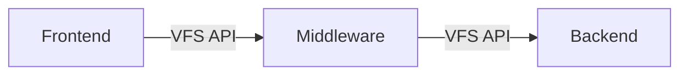

# Cryptomator VFS

High-level architecture:

- Frontend: a way to access a VFS, for example FUSE or WebDAV
- Middleware: transforms access, for example encryption or caching
- Backend: stores the physical files, for example via Java NIO

The common API between layers is the `vfs-api`. Shared building blocks live in `vfs-common`.

Subprojects:

- [`vfs-api`](vfs-api): common VFS API between layers
- [`vfs-common`](vfs-common): shared code used by implementations
- [`vfs-frontend-fuse`](vfs-frontend-fuse): frontend for FUSE-based access
- [`vfs-frontend-webdav`](vfs-frontend-webdav): frontend for WebDAV-based access
- [`vfs-middleware-crypto`](vfs-middleware-crypto): middleware for encrypting writes and decrypting reads
- [`vfs-backend-nio`](vfs-backend-nio): backend for Java NIO-based storage
- [`vfs-test`](vfs-test): executable wiring for manual end-to-end testing
