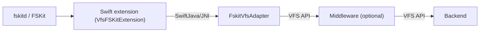

# vfs-frontend-fskit

Frontend module. Adapts the VFS API to [FSKit](https://developer.apple.com/documentation/fskit), Apple's userspace file-system framework (macOS 15.4+, path-backed resources since macOS 26).

## Architecture

Unlike FUSE — where jFUSE hosts the mount inside the JVM process — an FSKit file system is a Swift ExtensionKit extension (`.appex`, extension point `com.apple.fskit.fsmodule`) embedded in a host app, spawned by `fskitd`, signed and sandboxed. The JVM cannot be the extension process, so the Swift extension embeds a JVM in-process via [swift-java](https://github.com/swiftlang/swift-java) (JNI mode) and drives the Java VFS through generated bindings:



- **Java side** (`src/main/java`): `FskitVfsAdapter`, a flat, binding-friendly facade over `VfsFileSystem`. Only primitives, `String`, `byte[]`, and simple carrier records cross the JNI boundary; `IOException`s are translated to negative POSIX error codes the Swift side maps to `fs_errorForPOSIXError`.
- **Swift side** (`fskit/`): SwiftPM package with the FSKit extension (`VfsFSKitExtension`) and a stub host app (`VfsFSKitHost`), assembled and codesigned by `fskit/scripts/package.sh` — no `.xcodeproj`.

## Facade contract

- Open-file handles are strictly positive `long`s; `0` is the invalid-handle sentinel.
- Mutating operations return `0` on success or a negative POSIX error code.
- Object-returning operations return a carrier record holding `errorCode` plus the value.
- `read` returns a carrier with the bytes read (empty = EOF) because the Swift bindings pass arrays by value, without copy-back; `write` returns the byte count or a negative error code.
- Timestamps cross the boundary as epoch seconds + nanos; `Long.MIN_VALUE` seconds means "not set".
- Open flags, POSIX mode bits, and access masks use macOS native encodings (see `FskitVfsAdapter`).

## Baseline

macOS 26+, Swift 6.2+, Java 25.

## Build, enable, mount

```bash
# 1. Java side (facade + bootstrap + runtime deps in vfs-test/target/libs)
./mvnw package -DskipTests -pl vfs-test -am

# 2. Assemble VfsFSKitHost.app with the embedded .appex, jlink runtime, and jars.
#    This also runs `swift build`: bindings are generated by the SwiftJavaPlugin
#    from Sources/VfsFSKitExtension/swift-java.config (requires JAVA_HOME and the
#    Maven build above, since wrap-java reflects over target/classes).
#    Signing: any Apple-issued identity works (a free "Apple Development"
#    certificate is enough), but the provisioning profile is mandatory — see
#    "Signing" below.
cd vfs-frontend-fskit/fskit
JAVA_HOME=<jdk25> \
CODESIGN_IDENTITY="Apple Development: …" \
PROVISIONING_PROFILE=<profile authorizing fskit.fsmodule for the appex bundle ID> \
scripts/package.sh

# 3. Install, register, and enable
ditto build/VfsFSKitHost.app /Applications/VfsFSKitHost.app
codesign --verify --deep --strict /Applications/VfsFSKitHost.app  # must pass
open /Applications/VfsFSKitHost.app
# System Settings > General > Login Items & Extensions > File System Extensions
# -> use the "By Category" view, then enable "Cryptomator VFS File System
#    Extension". The toggle silently no-ops in the "By Application" view
#    (macOS 26.x).
pluginkit -m | grep -i vfs

# 4. Mount any directory as a mirror (the test wiring is NIO backend only;
#    see FskitVfsBootstrap in vfs-test)
mkdir -p /tmp/vfsmnt
mount -F -t vfsfs <sourceDir> /tmp/vfsmnt
umount /tmp/vfsmnt
```

`/sbin/mount` is the mounting interface for path-backed FSKit file systems; DiskArbitration only covers block devices.

## Design notes

- **Item lifecycle**: FSKit is item-based. `VfsItem` carries the current VFS path, a stable 64-bit item ID, the open Java handle, granted open modes, and an `unlinked` flag — removed items stay alive (and readable/writable through the retained Java handle) until `reclaimItem`.
- **Open-mode escalation**: `openItem` can widen modes over an item's lifetime; a `READ`-only `VfsFile` cannot be upgraded in place, so the volume opens a new Java handle with the widened mode set, swaps it in, and closes the old one.
- **Concurrency**: all Java calls and item-table mutations run on the `VfsItemTable` actor, which is pinned to a single dedicated thread (`JavaThreadExecutor`) because JNI environments are thread-bound. Full serialization also keeps the bridge safe for middleware that is not thread-safe, such as read-modify-write encryption (the FUSE wiring mounts single-threaded via `-s` for the same reason; FSKit offers no such option).
- **Logging**: the extension's JVM forces slf4j-simple to `info` so the test harness's debug logging cannot leak file paths into unified logs; set `VFS_FSKIT_DEBUG=1` to restore debug logging.

## Bridge constraints

- `swift build` requires `JAVA_HOME` to point at a JDK 25: the SwiftJavaPlugin's `wrap-java` tool boots a JVM to reflect over `target/classes` and fails on older runtimes with `UnsupportedClassVersionError`.
- The extension executable must be linked with `-e _NSExtensionMain` (see `Package.swift`). Xcode does this implicitly for appex targets; with the default Swift entry point, ExtensionFoundation aborts with `Unrecognized extension type` and the extension exits before serving XPC, which surfaces as `mount: Couldn't communicate with a helper application`.
- jdeps must analyze **all bundled jars as roots** (`--list-deps`, filtered to `java.*`/`jdk.*`) to derive the JDK module union for jlink; analyzing only the modular `vfs-test` jar yields library module names jlink cannot use.

## Signing

The appex carries the restricted `com.apple.developer.fskit.fsmodule` entitlement, which must be backed by a provisioning profile: ExtensionKit refuses to launch an unprovisioned extension at mount time (`com.apple.extensionKit.errorDomain error 2`), so ad-hoc builds compile and register but cannot mount. Any Apple-issued identity satisfies this, including a free "Apple Development" certificate. Hardened runtime and notarization are *not* needed for local development — Gatekeeper only evaluates quarantined downloads, and the embedded JVM's JIT works without entitlements when hardened runtime is off.

Pitfalls beyond that:

- **A broken seal fails opaquely.** `fskitd` will not launch a bundle whose signature is invalid; the only symptoms are `mount: Couldn't communicate with a helper application` and a kernel `AppleSystemPolicy` denial, with no crash report. After replacing the installed app, always gate on `codesign --verify --deep --strict /Applications/VfsFSKitHost.app`.
- **If notarizing for distribution, staple only the outer app.** Stapling the nested `.appex` writes a ticket file into the sealed appex (`Contents/CodeResources`) and invalidates the outer app's signature; the app-level ticket covers the embedded extension.

## Deferred

Encryption middleware in the FSKit wiring (the test bootstrap mirrors a plain directory through the NIO backend), extended attributes, and performance (FSKit's read/write path is currently slower than macFUSE).
