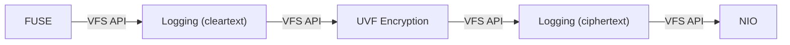

# vfs-test

Executable wiring for manual end-to-end testing.

`VfsTestMain <vaultDir> <mountPoint> [fuseLibraryPath]` mounts the vault in `vaultDir`. If neither `vault.uvf` nor `d/` exist there, a new password-protected vault is created first; the throwaway recovery key is only logged. Existing vault files are never overwritten. The password comes from `VFS_VAULT_PASSWORD` or a console prompt. The mount is single-threaded; on macOS it uses Cryptomator's macFUSE flags (`-oatomic_o_trunc -oauto_xattr -oauto_cache -onoappledouble -odefault_permissions`), and `VFS_MOUNT_FLAGS` appends further flags.

