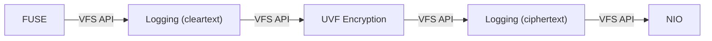
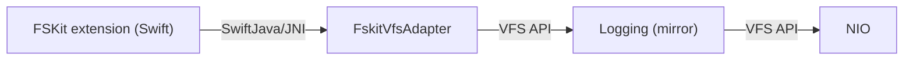

# vfs-test

Executable wiring for manual end-to-end testing.

## FUSE flow (`VfsTestMain`)

## FSKit flow (`FskitVfsBootstrap`)

A plain directory mirror driven by the Swift FSKit extension in [`vfs-frontend-fskit`](../vfs-frontend-fskit) through the `FskitVfsAdapter` facade — no encryption middleware, so the bridge can be exercised in isolation. `FskitVfsBootstrap.create(rootDir)` is the single entry point the extension calls.

`mvn package` additionally copies all runtime dependencies to `target/libs/`, which `vfs-frontend-fskit/fskit/scripts/package.sh` bundles into the extension together with `target/vfs-test-*.jar` (the jar holding `FskitVfsBootstrap` itself).
